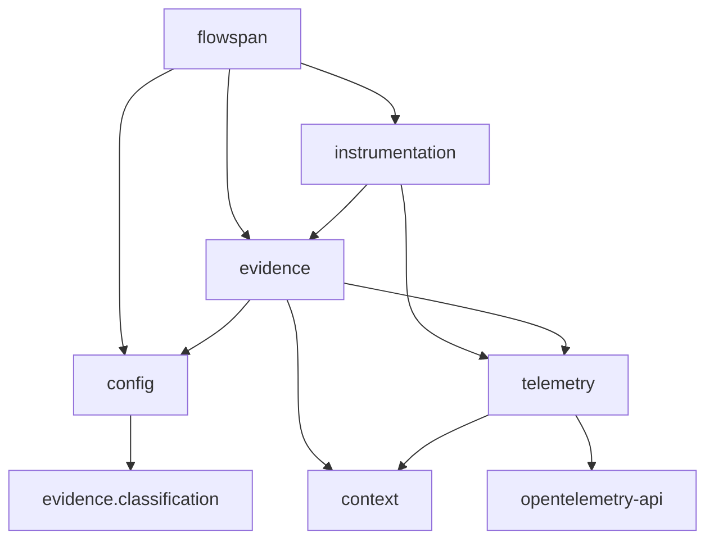

# Flowspan design

## Principles

- **Mechanisms, not conventions.** Flowspan never defines a client's exceptions,
  decisions, or framework wiring. It provides ways to classify and record them.
- **One span per entry**, carrying that entry's decisions and exceptions.
- **One annotation**, `@flowspan(FunctionType.X)`.
- **The application owns OpenTelemetry.** Flowspan uses `opentelemetry-api` only.

## Package layout

```
flowspan/
  __init__.py            public facade
  config.py              Settings, configure(), current_settings()
  errors.py              FlowspanError, UnknownOutcomeError
  types.py               FunctionType, ExceptionKind, Outcome
  instrumentation/       decorator.py, handlers.py, call_site.py
  context/               records.py, scope.py
  evidence/              classification.py, exceptions.py, decisions.py
  telemetry/             conventions.py, formatting.py, instruments.py, span_writer.py
```

Dependencies point one way:



`context` is plain Python and imports neither OpenTelemetry nor anything else
in Flowspan besides records and enums. Only `telemetry` imports OpenTelemetry.

## The decorator picks a strategy

`flowspan(function_type)` looks up a handler in a read-only mapping keyed by
`FunctionType`; an import-time check fails if a member has no handler. Each
handler exposes `scope(call)`, a context manager. The sync and async wrappers
are both `with handler.scope(call): return fn(...)`, so each lifecycle is
written once. Everything fixed about the function is computed once at
decoration time into a `CallSite`. Handlers hold no per-call state.

## Scopes

Two `ContextVar`s hold immutable tuples: the stack of `EntryScope`s and the stack
of `Frame`s. Pushing creates a new tuple and a token; popping resets the token,
even when the body raises. An `EntryScope` is mutable and holds the decisions, the
exceptions, and the exceptions already seen. It holds no span; the handler keeps
the span and passes it to `telemetry.span_writer` when the entry ends.

- **Nested entries.** An `ENTRY` call pushes a new scope. Recording writes to the top
  of the stack.
- **Concurrency.** `asyncio` copies the context per task, so concurrent
  nested entries push onto separate copies of the stack.
- **Deduplication.** The check walks the whole stack, and a popped scope's
  seen exceptions merge into the parent. An exception that leaves a nested entry is
  recorded on the nested entry only. Holding the exception object prevents its id
  from being reused while the entry runs.

## Lifecycles

Entry:
1. Start a span named after the function, with OpenTelemetry's automatic
   exception handling off, and set the three identity attributes.
2. Push the scope and an `ENTRY` frame.
3. On an `Exception`: record it; if it is unexpected, add an `exception` event
   and set status `ERROR`; re-raise.
4. Always write the non-empty evidence lists to the span, then pop.

Rule, helper, and client: outside an entry, call through. Inside, push a
frame; a propagating `Exception` is recorded and counted by the innermost
function it leaves; a normal return counts a success.

## Classification

`classify(exc)` asks the configured classifier first. A classifier that returns
`None` or raises falls through to the `TypeRegistry`, where the nearest
registered class in the MRO wins. Anything else is unexpected. The registry
replaces its mapping under a lock, so lookups need no lock.

## Decisions

`Decision[O]` is a handle created once per decision. Creating it registers the
name; the same name with the same outcomes is allowed, so modules can be
reloaded. `record` validates the outcome, raising `UnknownOutcomeError`, and
appends to the innermost entry.

## Settings

`Settings` is a frozen dataclass. `configure(**changes)` builds a new instance
with `dataclasses.replace` under a lock and swaps it in. Readers take the
current instance without locking.

## Names

All names are constants in `telemetry/conventions.py`: Flowspan's own attributes
are under `flowspan.*`, and the qualified function name uses the OpenTelemetry
`code.function.name` convention. There is one counter, `flowspan.function.calls`,
with the outcome and function type as attributes. Service identity comes from
the application's OpenTelemetry Resource.

## Errors raised by Flowspan

- `TypeError` at decoration time for a non-enum function type or a generator,
  and from `classify_as_*` for a non-exception type.
- `ValueError` for an invalid `Decision` or `Settings`.
- `UnknownOutcomeError` for an undeclared outcome.

Span and metric operations go through the OpenTelemetry API, which never raises
into application code.
